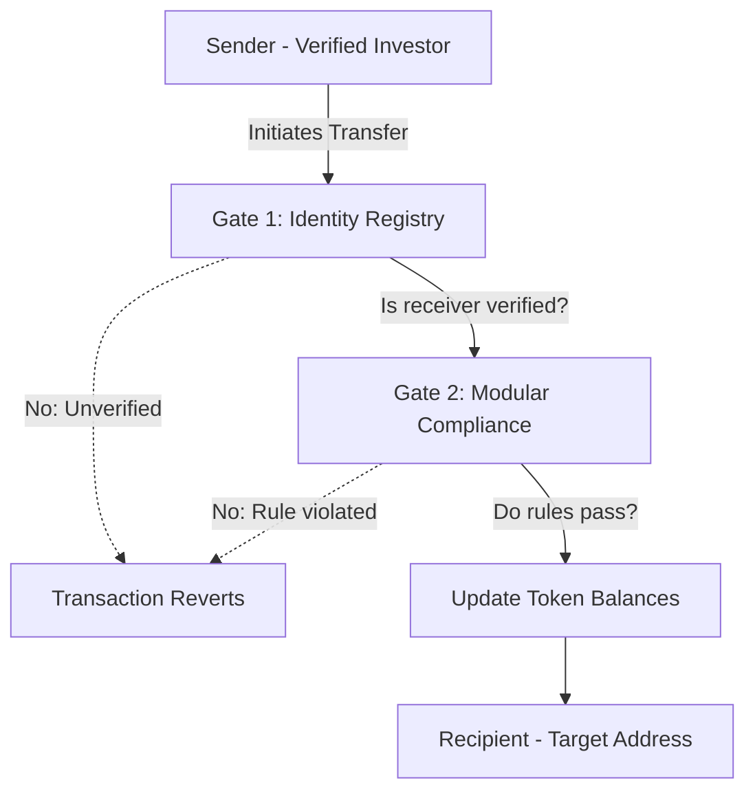

# 🏛️ AssetGate

> **Institutional-grade ERC-3643 Tokenization & Compliance Platform**
> A compliance-by-design platform for tokenizing regulated real-world assets (RWA), where every transfer is gated on-chain by investor identity and configurable compliance rules.

[](https://opensource.org/licenses/MIT)
[](https://www.typescriptlang.org/)
[](https://book.getfoundry.sh/)
[](https://github.com/jevinjojo/AssetGate/actions)
[](https://assetgate.vercel.app/)

---

## 🚀 Live Demo & Infrastructure

The full stack is deployed live on Sepolia testnet and cloud infrastructure. 

- **Frontend Dashboard:** [Live on Vercel](https://assetgate.vercel.app)
- **Backend API & Indexer:** [Live on Render](https://assetgate.onrender.com/api/v1/health)
- **Database:** Neon Serverless PostgreSQL
- **Smart Contracts:** Deployed and verified on Sepolia (ERC-3643 Core + Identity Registry)

---

## 🔒 The Problem & The Solution

### The Problem
1. **Public blockchains are permissionless, but securities are not.** Standard ERC-20 tokens can be held by anyone, making them fundamentally incompatible with regulated financial assets (equity, real estate, bonds) which require strict KYC/AML checks, investor accreditation, and jurisdictional restrictions.
2. **Off-chain compliance is fragile.** Relying on centralized off-chain databases to manually freeze wallets or revert illegal transfers defeats the purpose of tokenization and introduces severe settlement risks.

### The AssetGate Solution
1. **The Two-Gate Transfer Model.** AssetGate uses the ERC-3643 (T-REX) standard. Unlike normal tokens, every transfer first asks *"is this allowed?"* and **reverts** if not.
2. **Gate 1: Identity Registry.** Validates if the receiver is a verified investor by checking signed claims on their `ONCHAINID` from a trusted issuer.
3. **Gate 2: Modular Compliance.** Executes pluggable rule modules (e.g., maximum holder count, balance caps, country restrictions). If either gate fails, the transfer reverts natively at the smart contract level.

---

## ✨ Key Features

| Feature | Description |
|---|---|
| 🛂 **Identity Gating** | Enforces KYC/eligibility natively via `ONCHAINID` (ERC-734/735) signed claims. Unverified wallets cannot receive tokens. |
| 🧩 **Modular Compliance** | Custom Solidity rule modules (`MaxHolderCountModule`, `BalanceCapModule`, `CountryRestrictModule`) executed atomically on every transfer. |
| 🛑 **Corporate Controls** | Built-in issuer controls required by regulators: freeze, partial freeze, pause, burn, and force-transfer recovery. |
| 📡 **Live Event Indexer** | Viem-powered Node.js indexer that listens to ERC-3643 contract events, maps them to a relational schema, and stores them in PostgreSQL. |
| 📊 **Issuer Dashboard** | A highly polished React/Vite dashboard for issuers to manage cap tables, mint tokens, and execute corporate actions. |
| 🏛️ **Investor Portal** | A dedicated view for verified investors to view their eligible holdings and identity status. |
| 🧪 **Exploit-Tested** | Contracts rigorously tested via Foundry (unit + fuzz + boundary) to ensure restricted countries or unverified users can never bypass gates. |
| ☁️ **Cloud Native** | Built for production with Vercel, Render, and Neon PostgreSQL integrations out of the box. |

---

## 🏗️ Architecture

### The Two-Gate Model



---

## ⚡ Quickstart

### Prerequisites
- Node.js 20+
- Foundry (`forge`, `anvil`)
- A Sepolia RPC endpoint (Alchemy / Infura)
- Neon PostgreSQL database

### 1. Contracts & Local Chain

```bash
cd packages/contracts
npm install
forge build
forge test
anvil
```

In a second terminal:
```bash
cp .env.example .env
forge script script/DeployAll.s.sol --rpc-url anvil --broadcast
forge script script/Bootstrap.s.sol --rpc-url anvil --broadcast
```

### 2. Backend API & Indexer

```bash
cd packages/backend
cp .env.example .env
npm install
npx prisma generate
npx prisma db push
npm run dev
```

### 3. Frontend Dashboard

```bash
cd packages/frontend
cp .env.example .env
npm install
npm run dev
```

---

## 📁 Project Structure

```
AssetGate/
├── packages/
│   ├── contracts/
│   │   ├── src/                 # PermissionedToken, DependencyCheck
│   │   │   └── compliance/      # MaxHolderCount, BalanceCap, CountryRestrict
│   │   ├── script/              # DeployAll.s.sol, Bootstrap.s.sol
│   │   ├── test/                # EndToEnd, Fuzz, Boundary tests
│   │   └── deployments/         # Generated address artifacts
│   ├── backend/
│   │   ├── prisma/              # PostgreSQL schema
│   │   ├── src/
│   │   │   ├── api.ts           # Fastify REST endpoints
│   │   │   ├── indexer.ts       # Viem blockchain event listener
│   │   │   └── db.ts            # Prisma client instance
│   │   └── package.json
│   └── frontend/
│       ├── src/
│       │   ├── components/      # React: CapTable, IssuerControls, InvestorPortal
│       │   ├── App.tsx          # Main dashboard entrypoint
│       │   └── index.css        # Professional SaaS aesthetics
│       └── package.json
├── ARCHITECTURE.md
├── FLOWS.md
├── IDENTITY.md
├── README.md
```

---

## 🛠️ Tech Stack

| Layer | Tools |
|---|---|
| **Contracts** | Solidity, Foundry, ERC-3643 (T-REX), ONCHAINID |
| **Backend** | Node.js, Fastify, TypeScript, Viem, Prisma, PostgreSQL |
| **Frontend** | React, TypeScript, Vite, Wagmi, Custom CSS |
| **Infra / CI** | Vercel, Render, Neon, GitHub Actions |

---

## 🤝 Contributing

Contributions are welcome — please open an issue first to discuss any major change.

---

## ⚠️ Disclaimer

AssetGate is an educational/portfolio project demonstrating the ERC-3643 standard. KYC is simulated (the deployer acts as the trusted claim issuer). It is **not** audited, **not** production-ready, and **not** legal or financial advice. Deploying real securities involves substantial legal and regulatory obligations.

---

## 📄 License

MIT License — see [LICENSE](./LICENSE).

---

## 👤 Author

Built by **[Jevin Jojo](https://github.com/jevinjojo)**.

---

*AssetGate: because regulated assets require absolute, on-chain compliance.*
